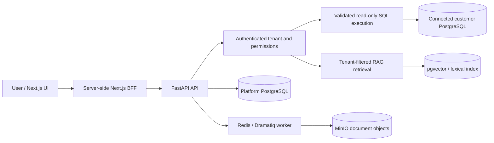

# Tenant Intelligence

**Secure LLM applications · Text-to-SQL · RAG · Multi-tenant backend engineering**

An independently built ITI AI training project demonstrating how an AI assistant can answer questions over tenant-authorized PostgreSQL data and uploaded documents **without letting the language model decide access rights**.

**Stack:** Python, FastAPI, PostgreSQL, SQLAlchemy, SQLGlot, pgvector, Redis, Dramatiq, MinIO, Next.js, TypeScript, LangGraph, Docker.

[**Architecture**](#architecture) · [**Trust model**](SECURITY.md) · [**API code**](api/) · [**Frontend**](frontend/) · [**Tests**](tests/) · [**Technical reference and original setup**](docs/reference/full-technical-reference-2026.md)

> **Project scope:** This is an engineering/training implementation, not an independently audited production product. See [limitations](#known-limitations).

## What is implemented

| Area | Engineering approach |
| --- | --- |
| **Text-to-SQL** | Allowed-schema retrieval, structured LLM calls, SQLGlot AST validation, row-filter injection and read-only query execution |
| **Tenant security** | Server-resolved tenant identity, role/table/column permissions, deny-by-default access, sensitive-column masking and audited query workflows |
| **Document RAG** | Tenant-scoped ingestion of text-based PDF/DOCX documents, asynchronous workers, locally generated embeddings, pgvector + lexical retrieval, and citations |
| **Hybrid answers** | Route authorized database and document evidence through a single grounded-answer workflow |
| **Application UX** | Next.js BFF, authenticated chat sessions, SSE response streaming, connection management, schema browsing and permission controls |
| **Operational tooling** | Docker Compose, PostgreSQL migrations, health checks, unit/integration tests and a reviewer bootstrap script |

## Architecture



**Security is an application responsibility, not an LLM prompt.** The backend resolves permissions and tenant identity from the authenticated context. Generated SQL is untrusted until parsed, checked against the effective schema, transformed with mandatory filters and executed with restricted rights. The BFF does not allow browser-controlled tenant identity. Details and caveats: [SECURITY.md](SECURITY.md).

## Important design decisions

**Fail closed on SQL:** Restrict the accepted AST to permitted read-only queries, enforce table/column permissions and filter rules, and mask sensitive fields before an answer model receives data.

**Keep evidence scoped:** Database and document citation metadata is normalized by backend policy; hidden data or document chunks are not exposed merely because the model requested them.

**Separate ingestion from interactive chat:** Background workers process uploads while the API handles authorization, retrieval and streaming response workflows.

**Reproduce the environment:** Use the existing Docker Compose, migration scripts and reviewer setup; external API services still require user-provided credentials.

## Run locally

**Requirements:** Docker Desktop with Docker Compose v2+, and your own valid Groq API key. No usable secrets are bundled.

Windows PowerShell:

```powershell
git clone https://github.com/ZeyadAli999/tenant-intelligence-platform.git
cd tenant-intelligence-platform
.\scripts\reviewer-setup.ps1
```

Linux / macOS:

```bash
git clone https://github.com/ZeyadAli999/tenant-intelligence-platform.git
cd tenant-intelligence-platform
chmod +x ./scripts/reviewer-setup.sh
./scripts/reviewer-setup.sh
```

Follow the script prompts to provide your own API key and administrator credentials. The stack exposes the frontend and FastAPI documentation on host ports reported by the script (typically 3000 and 8000).

**Fresh setup has no customer database connection or document knowledge base.** Create a permitted connection, configure access rules, and upload your own non-sensitive demonstration documents before evaluating source-grounded answers. See the [archived step-by-step reference](docs/reference/full-technical-reference-2026.md#reviewer-quick-start).

### Checks and tests

```bash
python -m pytest -q
```

```bash
cd frontend
npm ci
npm run typecheck
npm run lint
npm test
npm run build
```

These commands document the intended project checks; this README cleanup does **not** claim to have rerun them. Some integration/E2E workflows require running Docker services and disposable test identities.

## Code navigation

- [API and auth endpoints](api/) · [Main application](app/) · [LLM orchestration](agents/)
- [Policies and query execution](services/) · [Storage and persistence](repositories/)
- [Document worker](workers/) · [Evaluation cases](evals/)
- [Backend unit/integration tests](tests/) · [Next.js application](frontend/)
- [Security model and limitations](SECURITY.md)

## Known limitations

- PostgreSQL is the supported customer database adapter; broad SQL-dialect support is not claimed.
- PDF/DOCX text ingestion is supported. OCR, scanned-PDF content extraction and image interpretation are outside the documented scope.
- Runtime embedding artifacts or external model downloads may be necessary at first launch.
- The system has not been certified or independently penetration-tested as a production multi-tenant platform.
- AI-generated answers remain subject to model errors and should not be treated as a guarantee of completeness.

## Documentation history

The original **1,222-line** engineering and instructor-evaluation README is retained in [docs/reference/full-technical-reference-2026.md](docs/reference/full-technical-reference-2026.md). It contains detailed APIs, setup, development phases and historical evaluation instructions. It is preserved for traceability, not intended as the first page recruiters must read.
